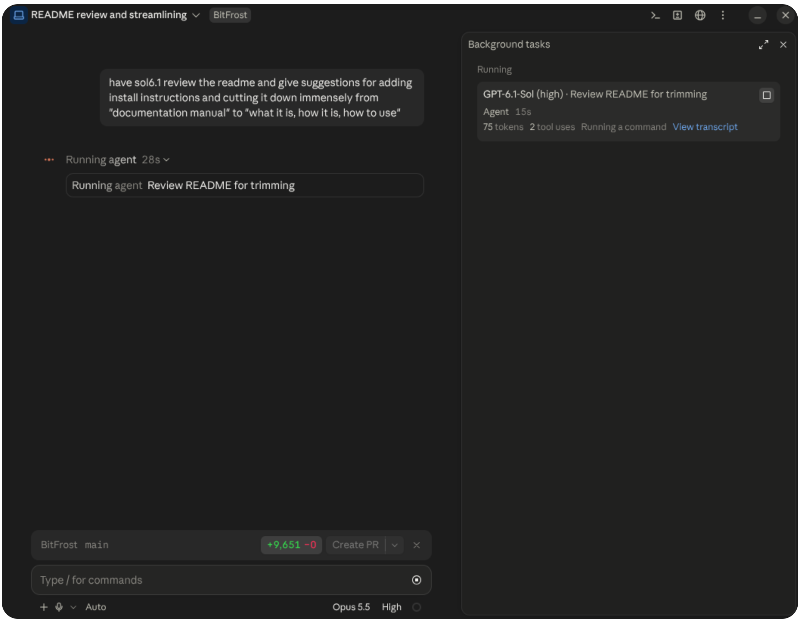
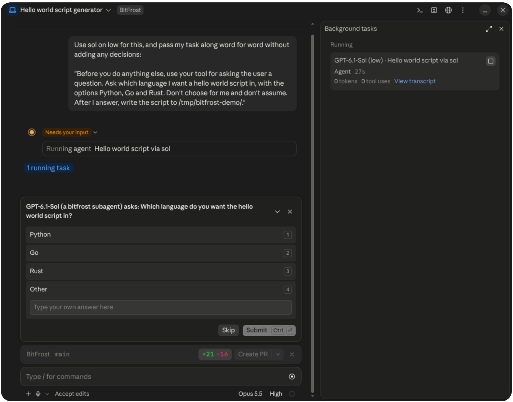
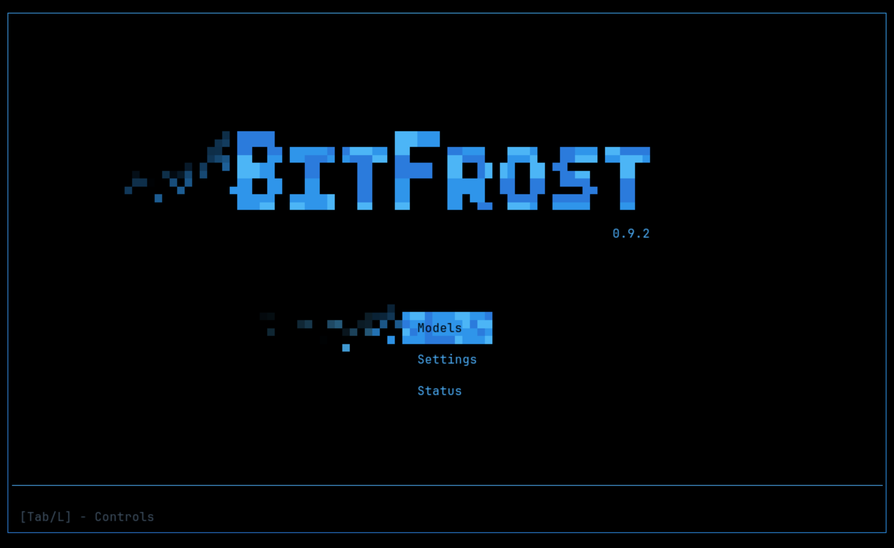
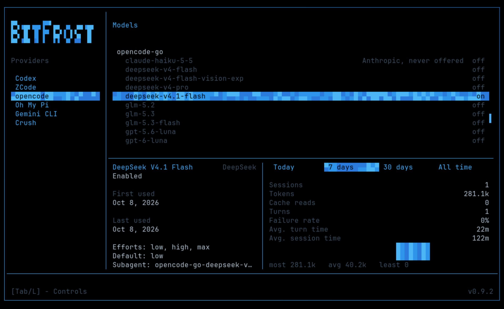

<p align="center"></p>

<h4 align="center">A bridge between agents</h4>

<p align="center">
  <a href="https://x.com/SavaSoftworks"></a>
</p>

---


<p align="center">
  <a href="https://github.com/SavaSoftworks/BitFrost/releases/latest"></a>
  <a href="https://github.com/SavaSoftworks/BitFrost/actions/workflows/release.yml"></a>
  <a href="LICENSE"></a>
  
  
  
  
</p>
<br />

BitFrost lets Claude Code delegate tasks to models through coding apps installed on your machine.

Works in Claude Code (CLI and desktop app), on Linux and macOS 12.3+.

<br />
<p align="center">
  
</p>
<br />

Subagent permission requests and questions come straight to you.

In auto mode, Claude answers subagent questions and a safety review decides permission requests.

<p align="center">
  
</p>

<br />

## Install


### Requirements

Node.js 23.6+, Claude Code, and at least one [supported coding app](#supported-harnesses) installed and authenticated.

<br />

### Installation

1. Add this to the `env` block of `~/.claude/settings.json`. This step is required:

   ```json
   "CLAUDE_CODE_ENABLE_FUNCTION_HOOKS": "1"
   ```

2. Run the installer:

   ```sh
   curl -fsSL https://github.com/SavaSoftworks/BitFrost/releases/latest/download/install.sh | sh
   ```

   It installs the plugin into Claude Code and adds a `bitfrost` command to `~/.local/bin`. Existing databases are backed up and migrated during installation, including any required history processing.

3. For GLM, sign in to ZCode's command-line tool ([command in the guide](GUIDE.md#zcode-glm)), then run once:

   ```sh
   bitfrost setup zcode
   ```

   Without it, GLM can't ask you for permission and is refused instead.

4. Start a new Claude session. New models also only show up in a new session.

If you use a Claude profile other than `~/.claude` (`CLAUDE_CONFIG_DIR`), see [Custom Claude profiles](GUIDE.md#custom-claude-profiles).

<br />

### Update

```bash
bitfrost update
```

If the new release has settings you haven't chosen, the CLI asks about them at the end. Updates from the TUI show **Configure new settings** on the main menu, with a recap before saving.

<br />

### Uninstall

```bash
bitfrost uninstall
```

This removes the Claude plugin, daemon, ZCode plugin (if installed) and BitFrost's installed files. It asks separately whether to delete your configuration and history, including usage stats, so you can keep them for a reinstall.

`--yes` removes everything without prompting; use `--keep-config` or `--keep-history` to preserve either.

<br />

## Configuration


Run `bitfrost` or `bitfrost config` in a terminal to open the interface:

```sh
bitfrost
```

<p align="center" float="left">


</p>

Models manages providers, models and usage statistics. Settings configures Claude profiles, official handback, history retention and app locations. Status shows sessions and daemon activity.

Press Tab, or your controller's left shoulder button, to view controls. Keyboard and mouse are supported on both platforms; gamepads such as Nintendo Switch Pro, DualSense and Xbox controllers are supported on Linux.

If the interface can't open on your platform, BitFrost prints help and tells you to edit `~/.config/bitfrost/config.json`.

<br />

## Supported Harnesses


Use any mix of these.

| Harness                                 | Models  | Turned on |
|-----------------------------------------|---------|---|
| Codex (CLI, or the ChatGPT desktop app) | GPT     | automatically, when installed and signed in |
| ZCode                                   | GLM     | automatically, when installed and signed in, plus one setup step |
| opencode, Oh My Pi, Crush               | Various | only once you turn them on in the config screen or `~/.config/bitfrost/config.json` |
| Gemini CLI                              | Gemini  | only once you turn it on, the same way |

Codex and ZCode are fully supported. The others are experimental.

opencode, Oh My Pi and Crush also need a `models` list naming the models you want. Setup for each app is in [the guide](GUIDE.md#setup). The config screen sets this up too, so you don't need to edit the file by hand.

<br />

## How to Use


Ask Claude for a model by name:

> Have sol6 on high review this change, then fix whatever it finds.

Claude is told at the start of each session which models you have and what they are called ("sol6", "glm", ...). If none can be offered, the session tells you why.

When a subagent asks for permission, the request comes to you, not Claude. No answer means Deny. In auto mode, a safety review decides instead.

[Official handback](GUIDE.md#what-is-official-handback) optionally uses a Claude model to return subagent reports through Claude Code's auto-mode safety classifier; it is off by default and adds Claude usage.

To see what the BitFrost daemon is doing and which apps it found:

```sh
bitfrost status
```

If something isn't working, see [Troubleshooting](GUIDE.md#troubleshooting).

<br />

## How to Use Effectively


Tell Claude which kinds of tasks each model should take on. For example:

> Use Opus and sol6.1 interchangeably for hard coding work, and balance the work between them. Use GLM for big mechanical refactors and tests. Use luna6 only for research and docs.

Once Claude understands the assignment, ask it to save that as a rule in your CLAUDE.md so every session follows it.

<br />

## Known Limitations


- GLM needs a Z.ai individual coding plan. ZCode only offers Teams, Start plans, free usage, bigmodel and its other providers inside its desktop app, not to outside tools, so BitFrost can't use them.
- Windows is not a supported platform. It may work via WSL, but it also may not.
- Gemini CLI requires Gemini Code Assist Standard/Enterprise, Google Cloud access or a paid API key. [Google ended free and Google AI Pro/Ultra access in June 2026](https://github.com/google-gemini/gemini-cli/discussions/27274). Antigravity CLI (`agy`) isn't supported yet.
- ZCode's own auto mode doesn't work. When Claude Code is in auto mode, BitFrost reviews GLM's permission requests with a short Claude (Sonnet) check instead, which counts toward your Claude usage.
- Oh My Pi may only ask permission for commands, deletes and moves, not ordinary file edits.
- In opencode, denying a permission request ends that subagent's turn.
- BitFrost disables opencode's subagents and Oh My Pi's advisor, subagents and prewalk. Crush uses your selected model for helper work such as titles and summaries too.
- Claude Code is the only app that can hand out work. Codex, ZCode and the rest can take tasks but can't start BitFrost subagents of their own.
- BitFrost relies on Claude Code's function hooks, which are still experimental. A Claude Code update, or Anthropic switching the feature off remotely, can turn BitFrost off until it's fixed.

<br />

## More

---

- [Guide](GUIDE.md): Configuration, troubleshooting, etc.
- [Contributing](CONTRIBUTING.md)


<br />

## Accounts, terms and affiliation


BitFrost runs supported coding apps on your machine. Those apps handle authentication and model requests using your accounts. You need valid access to each provider you use; usage counts toward that provider's limits and charges.

BitFrost does not resell or pool account access, or bypass quotas or access restrictions. You are responsible for following the applicable provider and app terms, including any plan or workplace restrictions.

BitFrost is an independent open-source project, not affiliated with, endorsed by or sponsored by the providers or app developers named here. Product names and trademarks belong to their respective owners and identify supported integrations.

Licensed under GPL-3.0-only, without warranty. See [LICENSE](LICENSE) for the full terms and limitations of liability.
